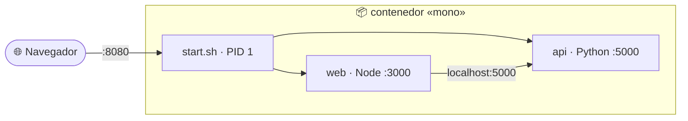
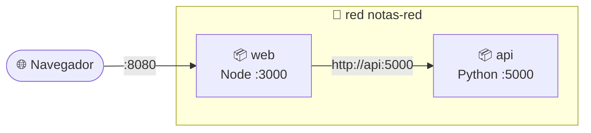
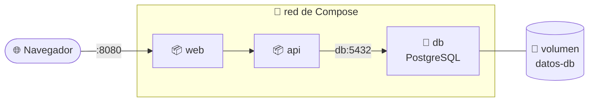
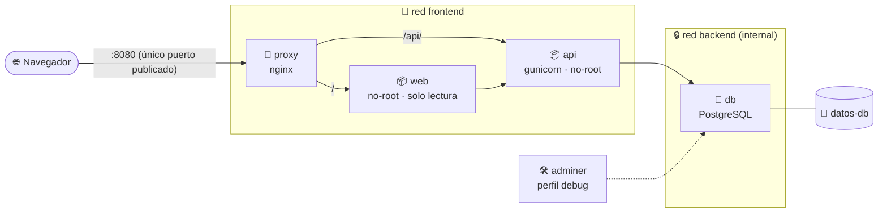

<div align="center">

# 🐳 Curso práctico de Docker

### De cero a una aplicación multi-contenedor lista para producción

**Teoría que se entiende · Ejemplos que funcionan · Experimentos para romper cosas · Ejercicios con solución**


[🚀 Empezar](#-empezar) · [📚 Temario](#-temario) · [🧵 La aplicación](#-la-aplicación-que-evoluciona) · [📋 Chuleta](CHULETA.md) · [🆘 Errores comunes](12-depuracion-y-errores/README.md)

</div>

---

## ✨ Por qué este curso

La mayoría de tutoriales de Docker te enseñan a copiar comandos. Este te enseña
**qué pasa por debajo**, para que cuando algo falle (y fallará) sepas por qué.

|  |  |
|---|---|
| 🧠 **Teoría de verdad** | Un contenedor no es una "mini máquina virtual": es un proceso de Linux con *namespaces* y *cgroups*. Lo comprobarás con `ps` en tu propia máquina. |
| 🧵 **Un hilo conductor** | Una misma aplicación evoluciona desde el anti-patrón (dos apps en un contenedor) hasta una arquitectura de producción con proxy, redes aisladas y base de datos. |
| 🧪 **Aprender rompiendo** | Cada módulo tiene experimentos para provocar los errores reales: `ENOTFOUND`, `ECONNREFUSED`, `Exited (137)`, datos que desaparecen, `docker stop` que tarda 10 s... |
| ✍️ **Ejercicios con solución** | Las soluciones están plegadas: inténtalo primero, ábrelas después. |
| ✅ **Todo probado** | Cada ejemplo, Dockerfile y `compose.yaml` se ha ejecutado contra Docker Engine 29 y Compose v2. |

---

## 🎯 Qué sabrás hacer al terminar

- [ ] Explicar qué es un contenedor, en qué se diferencia de una VM y cómo lo consigue el kernel.
- [ ] Manejar el ciclo de vida de los contenedores y diagnosticar por qué uno no arranca.
- [ ] Escribir Dockerfiles eficientes: caché de capas, *multi-stage*, usuario no-root, *healthchecks*.
- [ ] Persistir datos con volúmenes y hacer copias de seguridad.
- [ ] Conectar contenedores por red, entender el DNS interno y aislar servicios.
- [ ] **Separar una aplicación monolítica en varios contenedores** con un método repetible.
- [ ] **Añadir nuevos servicios** (base de datos, caché, proxy) a una aplicación existente.
- [ ] Orquestarlo todo con Docker Compose: dependencias, secretos, perfiles, límites de recursos.
- [ ] Aplicar buenas prácticas de seguridad y de producción.

---

## 🚀 Empezar

### 1. Instala Docker

En Ubuntu (también en una máquina virtual), sigue la guía paso a paso de
**[00 · Instalación](00-instalacion/README.md)**. Cuando esto funcione, estás listo:

```bash
docker run hello-world
docker compose version
```

### 2. Clona el curso

```bash
git clone https://github.com/SalmeronDevZone/curso-docker.git
cd curso-docker
```

### 3. (Opcional) Mira adónde vas a llegar

El proyecto final completo se levanta con tres comandos:

```bash
cd 11-proyecto-final/solucion
cp .env.example .env
docker compose up -d --build      # abre http://localhost:8080
docker compose down -v            # para y borra todo al terminar
```

Ahora vuelve a la raíz y empieza por la **[teoría](01-teoria/README.md)**. Al
final del curso entenderás cada línea de lo que acabas de arrancar.

---

## 📚 Temario

### Bloque 1 · Fundamentos

| # | Módulo | Qué aprendes | ⏱️ |
|:-:|--------|--------------|:--:|
| 00 | [**Instalación**](00-instalacion/README.md) | Docker Engine en Ubuntu, usarlo sin `sudo`, acceder a la VM desde Windows | 30 min |
| 01 | [**Teoría**](01-teoria/README.md) ⭐ | Contenedor vs VM, *namespaces*, *cgroups*, capas, imagen vs contenedor, PID 1, arquitectura, 7 experimentos | 1,5 h |
| 02 | [**Primeros pasos**](02-primeros-pasos/README.md) | `run`, `ps`, `logs`, `exec`, `inspect`, `stop`, `rm`... el ciclo de vida completo | 1,5 h |
| 03 | [**Imágenes y Dockerfile**](03-imagenes-y-dockerfile/README.md) | Todas las instrucciones, caché de capas, `.dockerignore`, `CMD` vs `ENTRYPOINT`, Docker Hub | 2 h |
| 04 | [**Volúmenes**](04-volumenes/README.md) | Volúmenes con nombre, *bind mounts*, *tmpfs*, permisos, copias de seguridad | 1,5 h |
| 05 | [**Redes**](05-redes/README.md) | Red *bridge*, DNS interno, publicar puertos, la trampa de `127.0.0.1`, UFW | 1,5 h |

### Bloque 2 · De monolito a multi-contenedor ⭐ *el corazón del curso*

| # | Módulo | Qué aprendes | ⏱️ |
|:-:|--------|--------------|:--:|
| 06 | [**Dos apps en un contenedor**](06-dos-apps-un-contenedor/README.md) | El anti-patrón: una API Python y una web Node en el mismo contenedor, y 8 problemas que provocarás tú mismo | 1,5 h |
| 07 | [**Separar en dos contenedores**](07-separar-en-dos-contenedores/README.md) ⭐ | **Método de 7 pasos** para separar cualquier aplicación, aplicado a mano con `docker run` | 2 h |
| 08 | [**Docker Compose**](08-docker-compose/README.md) | Toda la app en un `compose.yaml`; escalar la API y descubrir por qué hace falta una BD | 1,5 h |
| 09 | [**Meter otro contenedor: base de datos**](09-anadir-base-de-datos/README.md) ⭐ | PostgreSQL como tercer servicio: volumen, `.env`, *healthchecks*, `depends_on`, backups | 2 h |

### Bloque 3 · Producción

| # | Módulo | Qué aprendes | ⏱️ |
|:-:|--------|--------------|:--:|
| 10 | [**Buenas prácticas**](10-buenas-practicas/README.md) | *Multi-stage* (**1,34 GB → 7,3 MB**), señales y PID 1, no-root, secretos, límites, logs | 2 h |
| 11 | [**Proyecto final**](11-proyecto-final/README.md) | nginx + web + API + BD, dos redes aisladas, solo lectura, perfiles, backups. Con solución | 3 h |
| 12 | [**Depuración y errores comunes**](12-depuracion-y-errores/README.md) | Un método para diagnosticar y +40 errores frecuentes con su solución | 1 h |
| 📋 | [**Chuleta**](CHULETA.md) | Todos los comandos, un Dockerfile y un `compose.yaml` de referencia en una página | — |

> ⏱️ Los tiempos son orientativos, para alguien que empieza de cero y hace los
> ejercicios. Mejor una sesión por módulo que correr: **01, 07 y 09** son los
> que más conviene digerir.

---

## 🧵 La aplicación que evoluciona

Todo el bloque 2 y el proyecto final giran en torno a una mini-aplicación de
**notas** con dos piezas:

- **API** en Python (Flask) que guarda y devuelve las notas en JSON.
- **WEB** en Node.js (Express) que muestra una página y le pide los datos a la API.

La página indica **qué contenedor** ha servido la web y cuál ha servido los
datos, así que cada cambio de arquitectura se ve a simple vista.

### Etapa 1 — Módulo 06: todo en un contenedor (el anti-patrón)



Funciona... hasta que actualizas la web y pierdes las notas, se cae la API y se
reinicia todo, o quieres escalar solo una pieza.

### Etapa 2 — Módulos 07 y 08: un contenedor por aplicación



El único cambio de configuración: `API_URL` pasa de `localhost` al **nombre del
contenedor**. Primero a mano (07) y luego con Docker Compose (08).

### Etapa 3 — Módulo 09: añadimos un tercer contenedor



Las notas sobreviven a reinicios y la API ya se puede escalar a varias réplicas.

### Etapa 4 — Módulo 11: proyecto final



La web no puede ver la base de datos, la base de datos no tiene salida a
internet, cada servicio tiene *healthcheck* y límites de recursos, y hay un
script de copias de seguridad.

---

## 🗂️ Estructura del repositorio

```text
curso-docker/
├── 00-instalacion/                 Guía de instalación en Ubuntu
├── 01-teoria/                      Conceptos + experimentos
├── 02-primeros-pasos/              Comandos básicos + ejercicios
├── 03-imagenes-y-dockerfile/
│   ├── ejemplo/                    App Flask con Dockerfile comentado línea a línea
│   └── ejemplo-entrypoint/         CMD vs ENTRYPOINT
├── 04-volumenes/
│   └── web-estatica/               Para el experimento de bind mount
├── 05-redes/
├── 06-dos-apps-un-contenedor/      Dockerfile único + start.sh + api/ + web/
├── 07-separar-en-dos-contenedores/ api/ y web/ con su Dockerfile + arrancar.sh / parar.sh
├── 08-docker-compose/              compose.yaml + api/ + web/
├── 09-anadir-base-de-datos/        compose.yaml con PostgreSQL + .env.example + api v2
├── 10-buenas-practicas/
│   ├── multi-stage/                Go: 1,34 GB → 7,3 MB
│   ├── senales/                    PID 1 y SIGTERM
│   └── api-produccion/             Dockerfile de producción comentado
├── 11-proyecto-final/
│   └── solucion/                   compose.yaml, nginx/, api/, web/, scripts/
├── 12-depuracion-y-errores/
└── CHULETA.md
```

Cada carpeta de práctica es **independiente**: entra en ella y ejecuta sus
comandos sin depender de las demás.

---

## 🧭 Cómo leer cada módulo

Todos los módulos siguen la misma estructura: **objetivo → teoría → práctica
guiada → experimentos → ejercicios → limpieza**.

| Marca | Significado |
|:-----:|-------------|
| 🧠 | **Concepto**: teoría que conviene entender bien antes de seguir |
| 🧪 | **Experimento**: haz esto y observa qué pasa (a veces, a propósito, algo falla) |
| ⚠️ | **Ojo**: error típico o trampa |
| ✅ | **Comprueba**: cómo saber que lo has hecho bien |
| ✍️ | **Ejercicios**: la solución está plegada en *"Ver solución"* |

Consejos:

- **Escribe los comandos** en vez de copiarlos y pegarlos. Se aprende con los dedos.
- Ten **dos terminales**: una para ejecutar y otra para mirar logs (`docker logs -f ...`) o el estado (`watch docker ps`).
- Antes de cada comando, intenta predecir qué va a pasar. Después, comprueba si acertaste.

---

## 💻 Requisitos

| | Mínimo |
|---|---|
| Sistema | Ubuntu 22.04 o 24.04 (vale una máquina virtual) |
| CPU / RAM | 2 CPU · 4 GB |
| Disco | 20 GB libres (las imágenes del curso ocupan unos 5 GB) |
| Red | Conexión a internet para descargar imágenes |
| Conocimientos | Manejarte con la terminal de Linux (`cd`, `ls`, `cat`, `nano`). **No** hace falta saber Python ni Node |

¿Usas una máquina virtual y quieres abrir las aplicaciones desde el navegador
de tu ordenador? Mira la [sección 7 del módulo 00](00-instalacion/README.md#7-acceder-a-las-aplicaciones-de-la-vm-desde-windows).

---

## ❓ Preguntas frecuentes

<details>
<summary><b>¿Necesito saber Python o Node.js?</b></summary>

No. El código de la aplicación es corto y está comentado, pero el curso trata de
Docker: solo tocarás el código en un par de ejercicios muy guiados (cambiar un
título, por ejemplo).

</details>

<details>
<summary><b>¿Sirve con Docker Desktop en Windows o Mac?</b></summary>

Casi todo, sí. Las diferencias: la red `host` se comporta distinto, no puedes
ver los procesos de los contenedores con el `ps` de tu sistema (están dentro de
la VM de Docker Desktop) y rutas como `/var/lib/docker` no están a la vista. El
curso está pensado para Linux porque es donde Docker funciona de forma nativa y
donde corre en los servidores.

</details>

<details>
<summary><b>Algo no me funciona. ¿Qué hago?</b></summary>

1. Mira los logs: `docker logs <contenedor>` o `docker compose logs`. Es la
   respuesta en el 80 % de los casos.
2. Busca el mensaje de error en el [módulo 12](12-depuracion-y-errores/README.md).
3. Comprueba que no tienes contenedores de un módulo anterior ocupando el
   puerto 8080 (`docker ps`).
4. Si sigue sin funcionar, abre un *issue* con el comando y el error completo.

</details>

<details>
<summary><b>¿Por qué Docker Compose y no Kubernetes?</b></summary>

Porque Compose es la herramienta adecuada para aprender y para desplegar en una
sola máquina, y porque todos los conceptos (imágenes, servicios, redes,
volúmenes, *healthchecks*, secretos) se trasladan casi tal cual a Kubernetes.
Este curso es la base para dar ese paso después.

</details>

<details>
<summary><b>¿Cuánto espacio va a ocupar y cómo lo limpio?</b></summary>

Unos 5 GB entre todas las imágenes. Cada módulo termina con su sección de
limpieza. Para hacer limpieza general:

```bash
docker system df          # cuánto ocupa cada cosa
docker system prune -a    # borra todo lo que no esté en uso (pide confirmación)
```

</details>

---

## 🧹 Limpiar entre módulos

Varios módulos usan el puerto **8080**, así que antes de pasar al siguiente,
para lo del anterior (cada README te dice cómo). Si te lías:

```bash
docker ps                          # ¿qué hay en marcha?
docker compose down                # dentro de la carpeta de un módulo con compose.yaml
docker rm -f $(docker ps -aq)      # ⚠️ borra TODOS los contenedores de la máquina
docker system prune                # borra contenedores parados, redes sin usar y caché
```

---

## 🗺️ Y después, ¿qué?

1. **Registros e integración continua**: construir y publicar imágenes con GitHub Actions en cada `git push`.
2. **Kubernetes**: lleva el proyecto final a `minikube` o `kind`. Los *healthchecks* se convierten en *probes* y los servicios de Compose en *Deployments* y *Services*.
3. **Observabilidad**: Prometheus y Grafana en contenedores para vigilar tu aplicación.
4. **Seguridad**: escaneo de imágenes (Trivy, Docker Scout), modo *rootless* y firmado de imágenes.

---

## 🤝 Contribuir

¿Has encontrado un error, un comando que ya no funciona o una explicación que
se puede mejorar? Abre un [*issue*](https://github.com/SalmeronDevZone/curso-docker/issues)
o un *pull request*: cualquier mejora es bienvenida.

<div align="center">

---

Si este curso te ha sido útil, deja una ⭐ en el repositorio.

**¡A contenerizar!** 🐳

</div>
